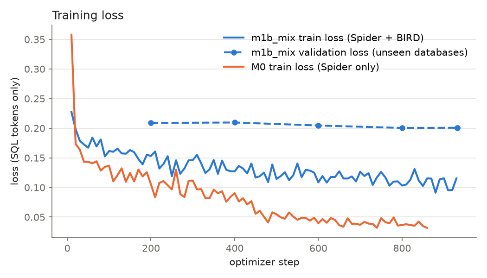
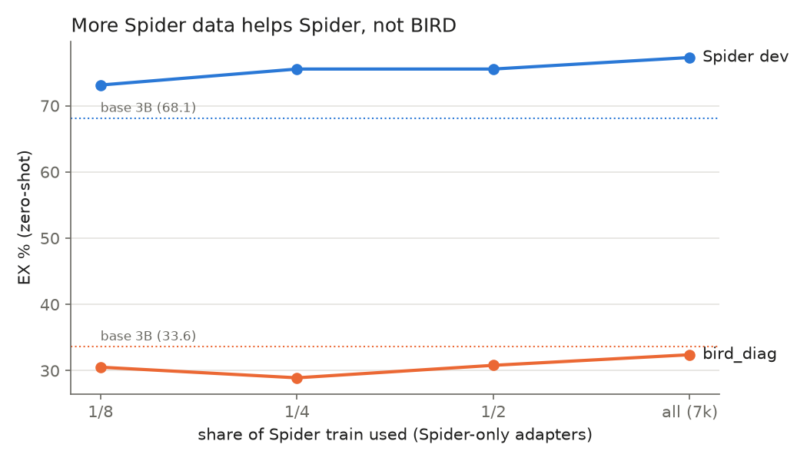
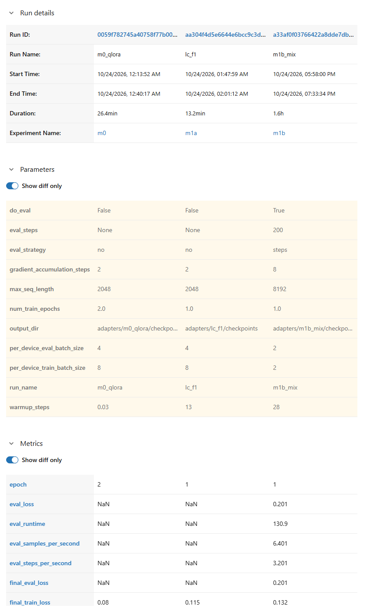

# sqltune

Fine-tuning Qwen2.5-Coder-3B-Instruct for text-to-SQL (SQLite) with QLoRA, served with vLLM and
measured by execution accuracy on Spider and BIRD Mini-Dev.

**Result.** A 3B model fine-tuned with QLoRA on Spider + BIRD train (15k examples, 93 min on
one 16 GB GPU, 3.9 GiB peak VRAM) gains **+6 to +10 EX on BIRD** over its own base and lands
**within noise of the 4-bit 7B model** of the same family. The same recipe gives the 7B no
detectable gain. Numbers are on held-out test sets, each run exactly once:

| model | variant | BIRD holdout EX | Spider test EX | train time / VRAM |
|---|---|---|---|---|
| Qwen2.5-Coder-3B base | zero-shot | 40.6 | 71.7 | — |
| Qwen2.5-Coder-3B base | rows + retry | 46.2 | 76.6 | — |
| 3B + Spider-only QLoRA (M0) | zero-shot | 36.1 | 77.7 | 26 min / 3.5 GiB |
| 3B + Spider-only QLoRA (M0) | rows + retry | 39.8 | 80.2 | |
| **3B + Spider+BIRD QLoRA (m1b_mix)** | zero-shot | **50.6** | 78.6 | 93 min / 3.9 GiB |
| **3B + Spider+BIRD QLoRA (m1b_mix)** | rows + retry | **52.2** | 80.9 | |
| Qwen2.5-Coder-7B AWQ | zero-shot | 46.6 | 78.7 | — |
| Qwen2.5-Coder-7B AWQ | rows + retry | 51.4 | 82.6 | — |
| Qwen2.5-Coder-14B AWQ | zero-shot | 54.2 | 82.5 | — |
| Qwen2.5-Coder-14B AWQ | rows + retry | 60.2 | 85.8 | — |

EX = execution accuracy, column-order tolerant (strict numbers and every other run:
[results/SUMMARY.md](results/SUMMARY.md)). *rows + retry*: the prompt shows 3 example rows per
table, and a query that fails to execute is retried once with the error message.
BIRD holdout = 250 Mini-Dev questions on 6 databases never used for any decision (249 scored:
one gold query runs longer than the 120 s gold timeout and is left out for every model).

- **BIRD train is what helps on BIRD.** m1b_mix vs base on BIRD holdout: +10.0 zero-shot
  (McNemar p = 3.5e-4, 95% CI +4.8 to +15.3) and +6.0 against the stronger rows + retry prompt
  (p = 0.024; 0.095 after Holm correction over the 8 test comparisons). The Spider-only
  adapter is *below* the base on BIRD.
- **3B fine-tune vs 7B: not distinguishable, not "equal".** Against the 4-bit 7B on BIRD
  holdout: +0.8 (p = 0.89, 95% CI −4.7 to +6.3). The average hides per-database swings
  (`financial` 6% vs 38%, `codebase_community` 58% vs 42%). Against a near-lossless FP8 7B
  on dev, the 3B is 4.4 points behind on BIRD (p = 0.18) and on Spider (p = 5e-4). 14B is
  ahead (−8.0 on BIRD holdout, p = 0.012; 0.06 after Holm).
- **Spider is not hurt** by adding BIRD (80.9 vs 80.2 for the Spider-only adapter, p = 0.25;
  within seed noise either way).
- **The same recipe does not lift the 7B** (dev sets, [004](docs/decisions/004-m1b-7b-finetune.md)).
  No detectable BIRD gain against its own base: +0.4 with AWQ 4-bit and 0.0 with FP8 (95% CI
  about ±5.5). The 3B gain minus the 7B gain on the same questions is **+10.4
  (95% CI +3.3 to +17.5)**: the 3B gain is significantly larger (question-level CI, one dev set).
  The 7B did learn, mostly the gold writing style: validation loss drops 45%, exact gold-string
  matches on unseen databases rise from 56 to 79, but EX gains only +7 on questions it trained
  on (seen once, 1 epoch), +2 on unseen databases and 0 on Mini-Dev. Its failures are mostly
  near ties at ambiguous forks (`LEFT` vs `INNER`, ×100 or not). With 8 samples, the fine-tune
  does raise pass@8 on Mini-Dev (+5.6, p = 0.03): the right answer is reachable, not chosen.
- **Sampling leaves room.** pass@8 is 12-19 points above greedy EX for every model; execution
  majority voting gives the 7B +6.0 on BIRD dev (no training, 8x inference). That gap is what
  a planned GRPO run on the 3B targets.
- **A prompt does not replace the 3B fine-tune.** A system prompt with SQLite rules (quoting,
  table prefixes, `strftime`, `CAST`) is no better for the base 3B on BIRD dev (−0.8, n.s.)
  and worse on Spider dev (−3.8, p = 3e-4); the fine-tune stays +13 above it on BIRD dev.

How it got there, one decision note per milestone:
[001](docs/decisions/001-m0-first-delta.md) first fine-tune on Spider ·
[002](docs/decisions/002-m1a-bird-baselines-sweeps.md) BIRD baselines and training sweeps ·
[003](docs/decisions/003-m1b-bird-train.md) adding BIRD train, error analysis, test runs ·
[004](docs/decisions/004-m1b-7b-finetune.md) the same fine-tune on 7B (merge → AWQ / FP8).

Every comparison in the decision notes (Δ, McNemar p, Holm-adjusted p, question-level and
database-level CIs, the difference in differences, per-database EX) is recomputed by
`uv run python scripts/paired_stats.py` from the prediction files in `results/`.

**Test sets were run once.** `bird_holdout` and Spider test only run with `run.test_once: true`,
which only the final configs set (the guard is in `runner.py`). MLflow holds exactly one run per
test-set config, and all 20 result folders were committed together (4af5c0d). The 5-point rule ("a dev difference under 5 EX points is
not a gain") was committed in the plan before the M1b training run.

### Caveats

- **Small evaluation sets.** Each BIRD half has 250 questions on 5-6 databases, so a 95% CI on
  a paired difference is about ±5 points. Database-level bootstrap CIs are wider and rough
  with so few databases. The full BIRD dev set (1,534 questions on the same 11 databases)
  would give about 3× the power; Mini-Dev (BIRD's curated 500-question subset) was chosen to
  keep each eval run short.
- **One seed per model.** Spider-only adapters varied by ~1.7 Spider-dev points across seeds
  (002), so Spider differences of that size are noise. The BIRD gains are well above it.
- BIRD holdout is a 6-database subset of Mini-Dev; numbers are not directly comparable with
  published Mini-Dev or BIRD-dev leaderboards.
- Spider test EX comes from this repo's harness, not the official test-suite evaluation.
- The 3B rows are served in bf16 (base + LoRA adapter); 7B and 14B are the official AWQ
  4-bit checkpoints (they do not fit the 16 GB card in bf16).
- The M0 adapter trained on Spider `soccer_1`, which holds the same data as the holdout
  database `european_football_2`; it still scores below the base on BIRD holdout.
- Qwen2.5-Coder may have seen Spider / BIRD in pre-training. Absolute scores may be inflated;
  differences against the same base model are still valid.
- BIRD gold SQL has known semantic errors. In a hand-labelled sample of 40 m1b_mix failures,
  6 were gold problems or ambiguous questions (003).

## Experiment tracking

Every training and eval run is logged to MLflow (`sqlite:///mlflow.db`, local; the database
is not in the repo, the run folders under `results/` are). Run `uv run mlflow ui` to browse.

- **Training runs:** the full config, train loss per 10 steps, validation loss on held-out
  databases every 200 steps, runtime, peak VRAM, and per-source counts (records, validation
  records, records dropped as too long, rows-prompt fallbacks). `results/<run>/train_summary.json`
  keeps the same numbers plus the MLflow run id.
- **Eval runs:** the full config, EX (strict and tolerant) with a database-level bootstrap CI,
  outcome counts by error type, latency and token counts, and the predictions file. Each eval
  run is tagged with the training run it evaluates (`train_run`, `train_mlflow_run_id`), the
  prompt variant and the eval set, so numbers can be traced back to their adapter (exceptions:
  M0 runs predate the `mlflow_run_id` field, and FP8 check runs carry no `train_run` tag).



Validation loss on unseen databases (completion tokens only) is 0.333 for the base 3B and
0.204 after fine-tuning (`scripts/val_loss.py`). During training it is already 0.209 at the
first check (step 200 of 932) and barely moves after that, so most of the gain comes in the
first fifth of the epoch. M0's train loss falls lower because it ran 2 epochs on Spider only.



More Spider data keeps helping Spider but never lifts BIRD above the base model; BIRD-style
data did (m1b_mix: 46.0 on bird_diag vs 33.6 for base).



MLflow's compare view for M0, the 1-epoch Spider run and m1b_mix: parameters that differ
and final metrics.

Training and evaluation build their prompts with the same function (`build_messages`). The
token-level check below was run for M0 only, on 11 Spider dev prompts (zero-shot, no evidence,
no example rows): `uv run --extra train python scripts/check_tokenize.py` (with
`make serve LORA=m0_qlora` running) → 22/22 identical.

## Reproduce

```bash
uv sync --extra train && make check-env
make download                  # Spider, BIRD Mini-Dev, BIRD train (~12 GB)
make dataset-review            # gold health + data/bird_train/gold_failures.json (needed by train)
make train CONFIG=experiments/configs/m1b/train/mix.yaml          # 3B, ~1.5 h
make serve-multi ADAPTERS="m0_qlora m1b_mix"                       # base + adapters on :8000
make m1-eval GROUP=m1b                                             # dev rows; see gen_m1_eval_configs.py
uv run sqltune summarize && uv run python scripts/paired_stats.py
```

7B: train with `m1b/train/mix7b.yaml`, then merge and quantize in a separate environment
(`requirements-awq.txt`): `scripts/merge_awq.py` (AWQ 4-bit, or `--no-quantize` for bf16
served as FP8). `scripts/oneoff/` holds the exact overnight drivers that produced the 003 / 004
runs. Adapters and quantized models are not in the repo (sizes); everything else is.

## Environment

Verified on an RTX 5080 16 GB (Blackwell, sm_120), driver 610.88, WSL2 Ubuntu 24.04, Python 3.12:

| Package | Version |
|---|---|
| torch | 2.14.1+cu130 |
| unsloth / unsloth-zoo | 2026.10.8 |
| bitsandbytes | 0.50.2 |
| transformers | 5.17.0 |
| trl | 1.15.0 |
| peft | 0.21.2 |
| vLLM (Docker) | v0.31.0 |

Setup: `uv sync --extra train`, then `make check-env`. Unsloth warns that the bundled xformers
wheel does not match torch 2.14 and falls back to PyTorch SDPA attention; that is harmless.

Docker needs the NVIDIA Container Toolkit for GPU access (`docker_gpu` in `make check-env`).

## Data

`make download` fetches the official Spider zip (2024 release, CC BY-SA 4.0) from Google Drive
and unpacks it into `data/spider/` (1.8 GB, git-ignored).

| Split | Questions | Used for |
|---|---|---|
| train (`train_spider.json`) | 7000 | SFT |
| train_others | 1659 | not used in M0 |
| dev | 1034 | baseline vs fine-tune comparison |
| test | 2147 | final numbers only (run once) |

166 SQLite databases under `database/` cover train and dev; dev databases do not appear in
train. If gdown hits Drive's quota, download the zip in a browser, save it as
`data/raw/spider.zip` and re-run `make download`.

**BIRD Mini-Dev (SQLite).** `make download` also fetches it: the questions come from
Hugging Face (`birdsql/bird_mini_dev`, the canonical copy) and the 11 SQLite databases from
the official zip (1.4 GB in `data/bird/`). It has 500 questions: 148 simple, 250 moderate and
102 challenging. Each question comes with an *evidence* hint, and that hint goes into the
prompt (BIRD's standard setup). The set is split by database:

| Half | Questions | Databases | Used for |
|---|---|---|---|
| `diag` | 250 | california_schools, card_games, formula_1, superhero, thrombosis_prediction | decisions, diagnostics |
| `holdout` | 250 | codebase_community, debit_card_specializing, european_football_2, financial, student_club, toxicology | headline numbers, once per final model |

The split is pinned in `DataConfig.bird_diag_dbs` (chosen once as the database subset closest
to 250 questions), so no seed or other setting can move holdout questions into diag.

**BIRD train (SQLite).** `make download` also fetches BIRD train (8.9 GB zip, 69 databases,
9,428 questions, `data/bird_train/`). M1b trains on it after these checks
(`make dataset-review`, notes in [docs/data/dataset-findings.md](docs/data/dataset-findings.md)):

- Databases with the same data as an eval database are removed: BIRD `world` and `airline`
  (Spider dev), and Spider train `formula_1` / `soccer_1` (BIRD Mini-Dev). Overlap is found by
  comparing table names, since the same public data appears under different database names.
- 402 questions whose gold SQL fails or returns > 100k rows are skipped (330 of them from
  `retail_world`).
- 5% of each source is held out as whole databases for validation loss.

Gold queries get their own timeout (`gold_timeout_s`, 120 s), because some BIRD gold
queries take ~26 s and would otherwise flip to `gold_error` from run to run (this happened
to `bird-0393` in 7 of the 20 M1a `bird_diag` runs, before this setting existed). BIRD runs
use `row_compare: set` and `exec_timeout_s: 30`. BIRD's official evaluator also compares sets
of rows but keeps column order, so the **strict** EX (in brackets in the tables) is the number
comparable to published BIRD results; the headline EX additionally tolerates column order.
